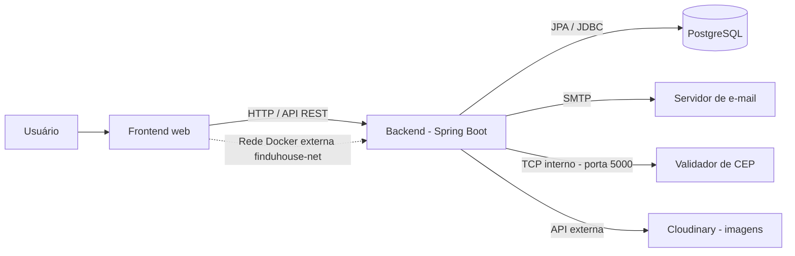

# Arquitetura do FindUHouse

## 1. Visão geral

O FindUHouse é organizado em serviços executados por contêineres Docker. O backend é uma API REST desenvolvida em Java com Spring Boot. Ele recebe as requisições do frontend, aplica as regras de negócio, acessa o PostgreSQL e integra-se aos serviços auxiliares de envio de e-mail, validação de CEP e armazenamento de imagens.

A configuração observada neste repositório utiliza quatro serviços no Docker Compose:

- `backend`: API Spring Boot.
- `database`: banco de dados PostgreSQL.
- `servidor-email`: serviço local de e-mail, construído a partir da pasta `servidor-email`.
- `validador-cep`: serviço auxiliar de validação/consulta de endereço, construído a partir da pasta `servidor-endereco`.

O frontend é mantido em repositório separado. O Compose deste repositório conecta o backend à rede externa `finduhouse-net`, utilizada também pela aplicação frontend.

## 2. Diagrama de contêineres



O diagrama representa as integrações identificadas nos arquivos de configuração do projeto. O frontend é externo a este repositório e não aparece como serviço no `docker-compose.yml` analisado.

## 3. Serviços e contêineres

| Serviço no Compose | Imagem / build | Porta interna | Porta publicada no host | Função |
|---|---|---:|---:|---|
| `backend` | Build de `./backend/Dockerfile` | 8080 | 8081 por padrão (`API_PORT`) | Disponibiliza a API REST |
| `database` | `postgres:16-alpine` | 5432 | 5432 por padrão (`DB_PORT`) | Armazena os dados da aplicação |
| `servidor-email` | Build de `./servidor-email/Dockerfile` | 25 | 2525 por padrão (`MAIL_PORT`) | Recebe os e-mails enviados pela aplicação no ambiente local |
| `validador-cep` | Build de `./servidor-endereco` | 5000 | Não publicada | Serviço auxiliar de validação/consulta de CEP |

As portas publicadas podem ser alteradas pelas variáveis indicadas entre parênteses. A porta interna é a utilizada na comunicação entre contêineres na rede Docker.

## 4. Comunicação entre os serviços

### 4.1 Frontend e backend

O frontend realiza requisições HTTP para a API do backend. No ambiente local descrito pelo Compose, a API é acessível pelo host na porta `8081`, encaminhada para a porta `8080` do contêiner.

A configuração de CORS é controlada pela variável `CORS_ALLOWED_ORIGINS`. Os valores padrão presentes no Compose incluem origens locais nas portas `8080` e `5500`.

### 4.2 Backend e banco de dados

O backend utiliza Spring Data JPA/Hibernate e o driver PostgreSQL. Dentro da rede Docker, a conexão padrão aponta para o host `database`, porta `5432`.

O serviço `database` possui healthcheck com `pg_isready`. O Compose configura o backend para aguardar o banco ficar saudável antes de iniciar.

O volume nomeado `postgres-data` mantém os dados do PostgreSQL entre reinicializações dos contêineres. O arquivo `init.sql` é montado em `/docker-entrypoint-initdb.d/init.sql` para inicialização do banco quando o volume é criado pela primeira vez.

### 4.3 Backend e servidor de e-mail

O backend utiliza a configuração SMTP apontada para `finduhouse-servidor-email`, porta interna `25`, sem autenticação e sem STARTTLS no ambiente local configurado em ``.

O serviço de e-mail também publica a porta `25` no host, usando `MAIL_PORT` (2525 por padrão). O Compose faz o backend depender do início desse serviço.

### 4.4 Backend e validador de CEP

O backend recebe o endereço do serviço por meio das variáveis `CEP_VALIDADOR_HOST` e `CEP_VALIDADOR_PORTA`. No Compose, elas são configuradas como `validador-cep` e `5000`, respectivamente. A porta não é publicada no host; a comunicação ocorre pela rede Docker.

### 4.5 Armazenamento de imagens

O projeto possui integração com Cloudinary para armazenamento de imagens. As credenciais são fornecidas pelas variáveis `CLOUDINARY_CLOUD_NAME`, `CLOUDINARY_API_KEY` e `CLOUDINARY_API_SECRET`. Não inserir valores reais dessas credenciais na documentação ou no repositório.

## 5. Rede Docker

O Compose declara uma rede externa chamada `finduhouse-net`. Como ela é externa, não é criada automaticamente por este arquivo. Antes de subir os serviços, a rede precisa existir:

```bash
docker network create finduhouse-net
```

Além dessa rede, os serviços também participam da rede padrão criada pelo Docker Compose. A rede externa permite a comunicação com serviços do frontend que estejam conectados à mesma rede.

**Observação importante:** no estado atual, a inicialização do backend por este Compose depende da criação prévia de `finduhouse-net`. Portanto, este repositório, isoladamente, não inicia todos os componentes a partir de um único comando em uma máquina sem preparação. Essa condição deve ser considerada ao descrever o procedimento de execução no documento de projeto.

## 6. Tecnologias identificadas

| Tecnologia / componente | Versão ou configuração identificada | Utilização |
|---|---|---|
| Java | 21 | Linguagem e runtime do backend |
| Spring Boot | 3.5.6 | Framework da API |
| Maven | Definido pelo projeto Maven; versão mínima não fixada no `pom.xml` | Gerenciamento de dependências e build |
| PostgreSQL | 16 (`postgres:16-alpine`) | Banco de dados relacional |
| Docker Compose | Sintaxe Compose V2 | Orquestração dos contêineres |
| Spring Data JPA / Hibernate | Dependência gerenciada pelo Spring Boot | Persistência e mapeamento objeto-relacional |
| Cloudinary | SDK `cloudinary-http5` 2.6.0 | Armazenamento de imagens |
| JUnit / Spring Boot Test | Dependência `spring-boot-starter-test` | Testes automatizados |

As versões acima foram extraídas dos arquivos `pom.xml` e `docker-compose.yml`. Quando o repositório não fixa uma versão específica, isso foi indicado na tabela.

## 7. Configurações e variáveis de ambiente

O Compose e o `application.properties` utilizam variáveis de ambiente para parametrizar a execução. Entre as principais:

| Variável | Finalidade |
|---|---|
| `API_PORT` | Porta publicada da API no host |
| `DB_NAME` | Nome do banco PostgreSQL |
| `DB_USER` | Usuário do banco |
| `DB_PASSWORD` | Senha do banco |
| `DB_PORT` | Porta publicada do PostgreSQL no host |
| `SPRING_DATASOURCE_URL` | URL JDBC de conexão |
| `SPRING_DATASOURCE_USERNAME` | Usuário da conexão JDBC |
| `SPRING_DATASOURCE_PASSWORD` | Senha da conexão JDBC |
| `MAIL_USERNAME` / `MAIL_PASSWORD` | Credenciais SMTP previstas no Compose |
| `CORS_ALLOWED_ORIGINS` | Origens permitidas para chamadas do frontend |
| `CLOUDINARY_CLOUD_NAME` | Identificação da conta Cloudinary |
| `CLOUDINARY_API_KEY` / `CLOUDINARY_API_SECRET` | Credenciais da integração Cloudinary |

Os valores sensíveis devem permanecer em arquivo `.env` local, não versionado. O repositório deve conter apenas um modelo sem credenciais reais, como `.env.example`.

## 8. Inicialização e dependências

O backend declara dependência de:

- `database`, condicionado ao status saudável (`service_healthy`);
- `servidor-email`, condicionado ao início do contêiner (`service_started`);
- `validador-cep`, condicionado ao início do contêiner (`service_started`).

O Compose não configura healthcheck para o backend, servidor de e-mail ou validador de CEP. A condição `service_started` confirma o início do contêiner, mas não garante, por si só, que a aplicação interna já esteja pronta para receber requisições.

## 9. Limites desta documentação

Esta documentação descreve a configuração encontrada no repositório backend enviado. A topologia completa de produção, o endereço de implantação, o comportamento operacional do frontend e a disponibilidade externa do Cloudinary dependem de configurações que não estão integralmente representadas neste repositório.
