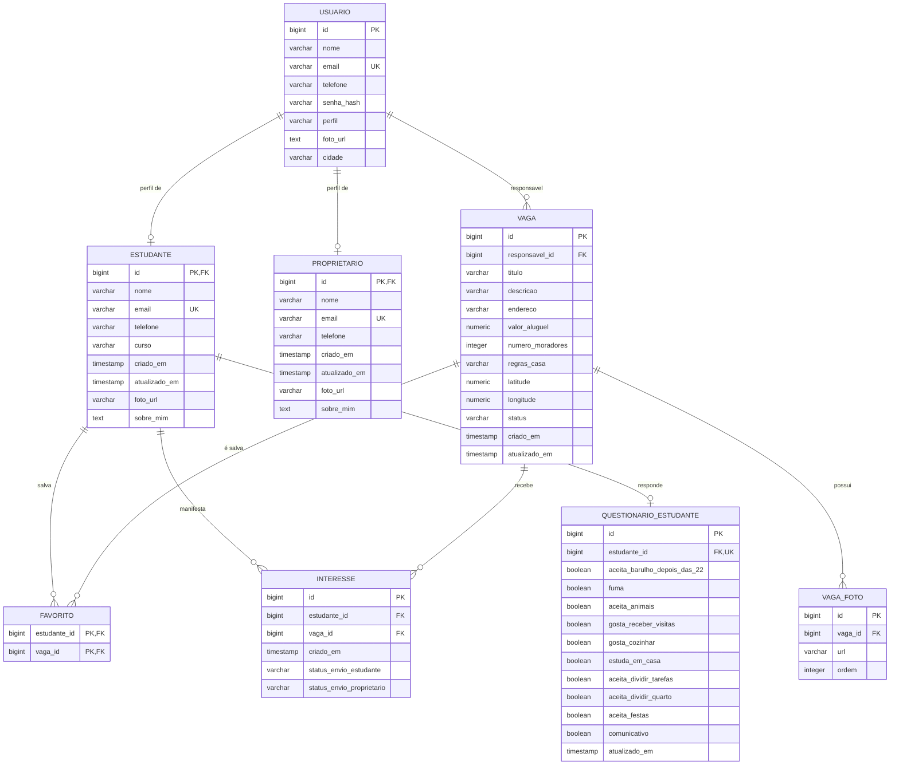

# Banco de dados do FindUHouse

## 1. SGBD e persistência

O projeto utiliza PostgreSQL 16, executado pelo serviço `database` do Docker Compose. O backend acessa o banco por meio do Spring Data JPA/Hibernate e do driver JDBC do PostgreSQL.

O banco padrão configurado no Compose é `finduhouse`. Nome, usuário, senha e porta podem ser parametrizados por variáveis de ambiente.

O arquivo `init.sql`, localizado na raiz deste repositório, contém a estrutura inicial das tabelas. O Compose monta esse arquivo no diretório de inicialização do PostgreSQL. Esse script de inicialização é executado pelo container oficial quando o diretório de dados é inicializado; não é reaplicado automaticamente a cada reinicialização de um volume já existente.

## 2. Diagrama entidade-relacionamento

O diagrama abaixo representa as tabelas e os relacionamentos declarados no `init.sql`.

**Nota:** os campos de regras de convivência da tabela `vaga` foram omitidos do desenho para manter a leitura. Eles estão descritos na seção da tabela `vaga`.

## 3. Descrição das tabelas

### 3.1 `usuario`

Armazena os dados comuns de autenticação e identificação dos usuários da plataforma, independentemente de serem estudantes ou proprietários.

| Campo | Tipo | Restrição / finalidade |
|---|---|---|
| `id` | `bigserial` | Chave primária |
| `nome` | `varchar(255)` | Obrigatório |
| `email` | `varchar(255)` | Obrigatório e único |
| `telefone` | `varchar(255)` | Obrigatório |
| `senha_hash` | `varchar(255)` | Obrigatório; armazena o hash da senha |
| `perfil` | `varchar(255)` | Obrigatório; limitado a `estudante` ou `proprietario` |
| `foto_url` | `text` | URL da foto, quando disponível |
| `cidade` | `varchar(100)` | Cidade informada no perfil |

### 3.2 `estudante`

Complementa o cadastro de `usuario` para usuários com perfil de estudante. A coluna `id` é simultaneamente chave primária e chave estrangeira para `usuario.id`.

| Campo | Tipo | Restrição / finalidade |
|---|---|---|
| `id` | `bigint` | PK e FK para `usuario.id` |
| `nome` | `varchar(255)` | Obrigatório |
| `email` | `varchar(255)` | Obrigatório e único |
| `telefone` | `varchar(255)` | Obrigatório |
| `curso` | `varchar(255)` | Obrigatório |
| `criado_em` | `timestamp` | Data de criação, com valor padrão |
| `atualizado_em` | `timestamp` | Data de atualização, com valor padrão |
| `foto_url` | `varchar(500)` | URL da foto |
| `sobre_mim` | `text` | Descrição do estudante |

### 3.3 `proprietario`

Complementa o cadastro de `usuario` para usuários com perfil de proprietário. A coluna `id` é simultaneamente chave primária e chave estrangeira para `usuario.id`.

| Campo | Tipo | Restrição / finalidade |
|---|---|---|
| `id` | `bigint` | PK e FK para `usuario.id` |
| `nome` | `varchar(255)` | Obrigatório |
| `email` | `varchar(255)` | Obrigatório e único |
| `telefone` | `varchar(255)` | Obrigatório |
| `criado_em` | `timestamp` | Data de criação, com valor padrão |
| `atualizado_em` | `timestamp` | Data de atualização, com valor padrão |
| `foto_url` | `varchar(500)` | URL da foto |
| `sobre_mim` | `text` | Descrição do proprietário |

### 3.4 `vaga`

Armazena os anúncios de moradia cadastrados pelos proprietários. A coluna `responsavel_id` referencia `usuario.id`.

| Campo | Tipo | Restrição / finalidade |
|---|---|---|
| `id` | `bigserial` | Chave primária |
| `responsavel_id` | `bigint` | FK para `usuario.id`; obrigatório |
| `titulo` | `varchar(255)` | Título do anúncio |
| `descricao` | `varchar(255)` | Descrição da moradia |
| `endereco` | `varchar(255)` | Endereço |
| `valor_aluguel` | `numeric(10,2)` | Valor do aluguel |
| `numero_moradores` | `integer` | Número de moradores |
| `regras_casa` | `varchar(255)` | Regras textuais da casa |
| `latitude` | `numeric(10,8)` | Latitude da moradia |
| `longitude` | `numeric(11,8)` | Longitude da moradia |
| `status` | `varchar(255)` | Restrição: `ativa` ou `inativa` |
| `aceita_barulho_depois_das_22` | `boolean` | Preferência de convivência |
| `fuma` | `boolean` | Informação sobre fumo |
| `aceita_animais` | `boolean` | Aceitação de animais |
| `gosta_receber_visitas` | `boolean` | Preferência sobre visitas |
| `gosta_cozinhar` | `boolean` | Preferência sobre cozinhar |
| `estuda_em_casa` | `boolean` | Informação sobre estudo em casa |
| `aceita_dividir_tarefas` | `boolean` | Preferência sobre divisão de tarefas |
| `aceita_dividir_quarto` | `boolean` | Aceitação de quarto compartilhado |
| `aceita_festas` | `boolean` | Preferência sobre festas |
| `comunicativo` | `boolean` | Característica de convivência |
| `criado_em` | `timestamp` | Data de criação |
| `atualizado_em` | `timestamp` | Data de atualização |

### 3.5 `favorito`

Relaciona estudantes e vagas salvas como favoritas. Utiliza chave primária composta por `estudante_id` e `vaga_id`, impedindo que a mesma vaga seja favoritada duas vezes pelo mesmo estudante.

| Campo | Tipo | Restrição / finalidade |
|---|---|---|
| `estudante_id` | `bigint` | PK composta e FK para `estudante.id` |
| `vaga_id` | `bigint` | PK composta e FK para `vaga.id` |

### 3.6 `interesse`

Registra o interesse de um estudante por uma vaga e o estado do envio das notificações correspondentes.

| Campo | Tipo | Restrição / finalidade |
|---|---|---|
| `id` | `bigserial` | Chave primária |
| `estudante_id` | `bigint` | FK para `estudante.id` |
| `vaga_id` | `bigint` | FK para `vaga.id` |
| `criado_em` | `timestamp` | Data de criação |
| `status_envio_estudante` | `varchar(20)` | `pendente`, `enviado` ou `falhou` |
| `status_envio_proprietario` | `varchar(20)` | `pendente`, `enviado` ou `falhou` |

A combinação `estudante_id` e `vaga_id` possui restrição `UNIQUE`, impedindo registros duplicados para o mesmo par.

### 3.7 `questionario_estudante`

Armazena as respostas de convivência de cada estudante. A coluna `estudante_id` é única, permitindo no máximo um questionário por estudante.

| Campo | Tipo | Restrição / finalidade |
|---|---|---|
| `id` | `bigserial` | Chave primária |
| `estudante_id` | `bigint` | FK para `estudante.id` e único |
| `aceita_barulho_depois_das_22` | `boolean` | Preferência sobre barulho |
| `fuma` | `boolean` | Informação sobre fumo |
| `aceita_animais` | `boolean` | Aceitação de animais |
| `gosta_receber_visitas` | `boolean` | Preferência sobre visitas |
| `gosta_cozinhar` | `boolean` | Preferência sobre cozinhar |
| `estuda_em_casa` | `boolean` | Informação sobre estudo em casa |
| `aceita_dividir_tarefas` | `boolean` | Preferência sobre tarefas |
| `aceita_dividir_quarto` | `boolean` | Aceitação de quarto compartilhado |
| `aceita_festas` | `boolean` | Preferência sobre festas |
| `comunicativo` | `boolean` | Característica de convivência |
| `atualizado_em` | `timestamp` | Data da última atualização |

### 3.8 `vaga_foto`

Armazena as URLs das fotos associadas a cada anúncio de moradia. A exclusão de uma vaga remove suas fotos relacionadas por meio da regra `ON DELETE CASCADE`.

| Campo | Tipo | Restrição / finalidade |
|---|---|---|
| `id` | `bigserial` | Chave primária |
| `vaga_id` | `bigint` | FK para `vaga.id`, com exclusão em cascata |
| `url` | `varchar(500)` | URL da imagem |
| `ordem` | `integer` | Ordem de exibição |

## 4. Relacionamentos e cardinalidades

| Relacionamento | Cardinalidade | Regra |
|---|---|---|
| `usuario` — `estudante` | 1 : 0..1 | Um usuário pode possuir um registro complementar de estudante |
| `usuario` — `proprietario` | 1 : 0..1 | Um usuário pode possuir um registro complementar de proprietário |
| `usuario` — `vaga` | 1 : 0..N | Um usuário responsável pode cadastrar várias vagas |
| `estudante` — `favorito` | 1 : 0..N | Um estudante pode salvar várias vagas |
| `vaga` — `favorito` | 1 : 0..N | Uma vaga pode ser favoritada por vários estudantes |
| `estudante` — `interesse` | 1 : 0..N | Um estudante pode manifestar interesse em várias vagas |
| `vaga` — `interesse` | 1 : 0..N | Uma vaga pode receber interesse de vários estudantes |
| `estudante` — `questionario_estudante` | 1 : 0..1 | Um estudante pode ter no máximo um questionário |
| `vaga` — `vaga_foto` | 1 : 0..N | Uma vaga pode possuir várias fotos |

## 5. Integridade e restrições

O script `init.sql` define as seguintes regras relevantes:

- Chaves primárias identificam os registros.
- Chaves estrangeiras mantêm os vínculos entre usuários, estudantes, proprietários, vagas, favoritos, interesses, questionários e fotos.
- O e-mail é único em `usuario`, `estudante` e `proprietario`.
- O perfil do usuário é limitado a `estudante` ou `proprietario`.
- O status da vaga é limitado a `ativa` ou `inativa`.
- Os estados de envio de interesse são limitados a `pendente`, `enviado` ou `falhou`.
- Um estudante não pode registrar duas vezes o mesmo favorito para a mesma vaga.
- Um estudante não pode registrar mais de um interesse para a mesma vaga.
- Um estudante pode possuir no máximo um questionário.
- A exclusão de uma vaga remove as respectivas linhas de `vaga_foto` por cascata.

## 6. Observações para manutenção

1. O diagrama e as descrições desta página foram elaborados a partir do `init.sql` e das entidades JPA presentes no repositório.
2. O Hibernate está configurado com `ddl-auto=validate` no `application.properties`. O `docker-compose.yml`, por sua vez, define `SPRING_JPA_HIBERNATE_DDL_AUTO=update` para o contêiner do backend. A configuração efetiva no ambiente Docker deve ser considerada ao executar a aplicação.
3. O `init.sql` não contém uma tabela específica para denúncias, embora existam contratos de denúncia no diretório de documentação. É necessário conferir a implementação e a estratégia de persistência desse recurso antes de afirmar que as denúncias são armazenadas em tabela própria.
4. As tabelas `estudante` e `proprietario` repetem dados de identificação presentes em `usuario`. A documentação mantém essa estrutura conforme encontrada no banco, sem propor alteração de modelagem.
